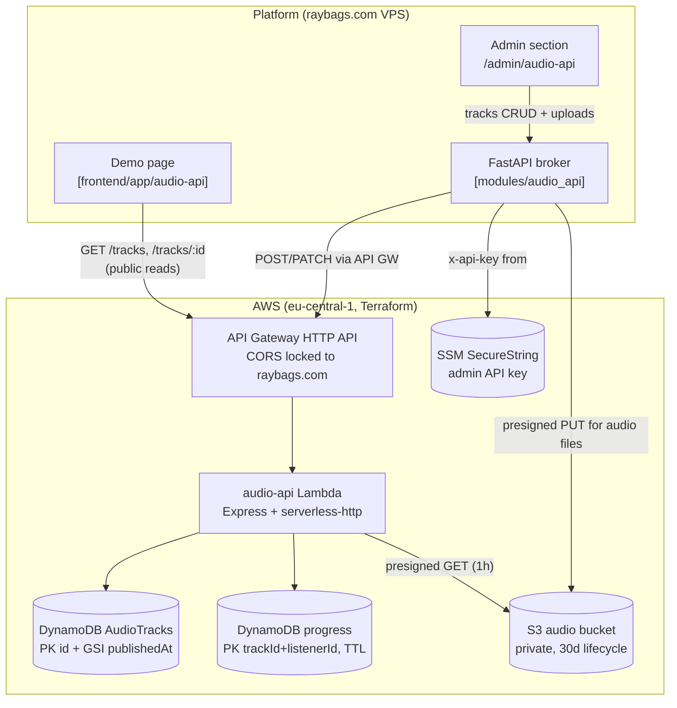

# Audio & Podcast Stream API — Architecture

Serverless REST API for podcast/audio metadata with secure streaming.
Public reads hit the API Gateway directly from the browser (near-zero cost);
admin writes are brokered through the platform with an admin API key stored
in SSM.

[Open the interactive diagram on GitDiagram](https://gitdiagram.com/raybags-dev/portfolio-base)

## Endpoints (Lambda, TypeScript strict)

| Route | Access | Purpose |
|---|---|---|
| `GET /tracks` | public | Paginated list, optional category filter |
| `GET /tracks/:id` | public | Metadata + 1h presigned stream URL |
| `POST /tracks` | admin (`x-api-key`) | Register episode (Zod-validated) |
| `PATCH /tracks/:id/progress` | public | Sync playback position |

## Cost guardrails

- PAY_PER_REQUEST DynamoDB; progress rows expire via TTL.
- 1h presigned GET URLs bound demo bandwidth.
- Admin key lives in SSM; the broker reads it with a scoped IAM user — never
  hardcoded, never shipped to the browser.
- `make down` tears the whole stack out.

## Key paths

| Piece | Location |
|---|---|
| Terraform module | `modules/audio-api/` |
| Lambda handler | `aws/handlers/audio-api/` (Phase 3) |
| Platform broker | `backend/app/modules/audio_api/` (Phase 3) |
| Demo page | `frontend/app/audio-api/` (Phase 3) |
