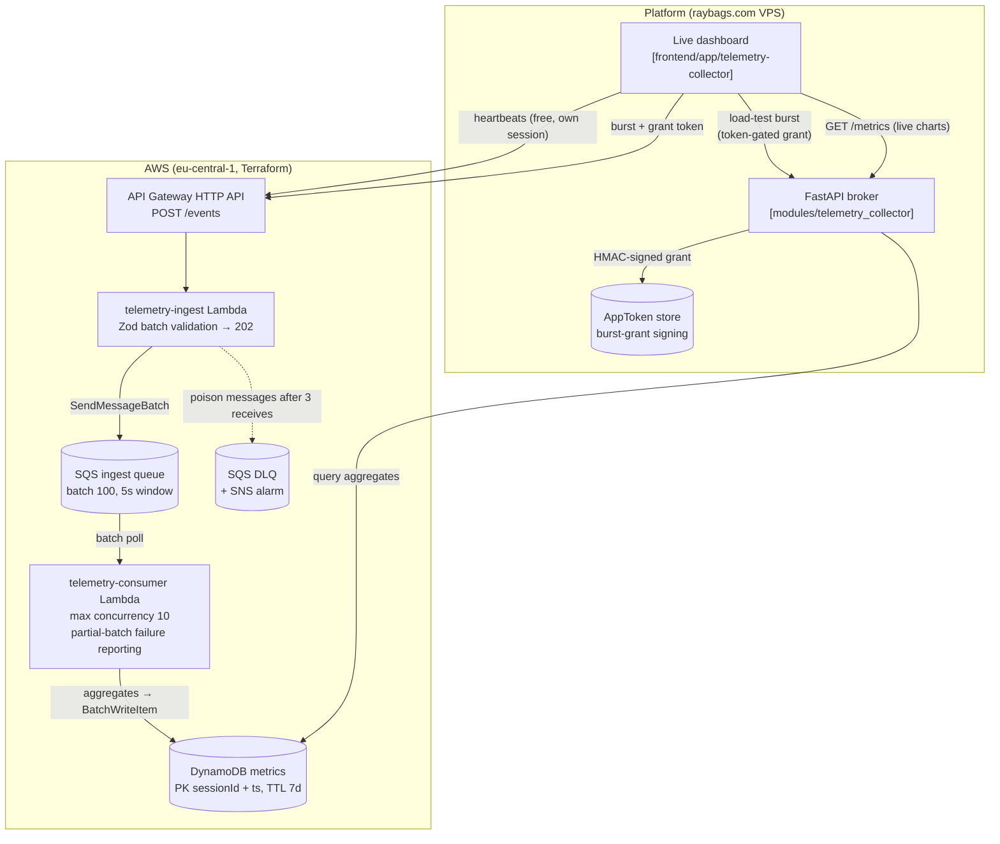

# Live Stream Telemetry Collector — Architecture

High-throughput ingestion backend for player telemetry (heartbeats, buffering
events, error metrics) from many concurrent streaming clients. Ingest is a
thin validate-and-enqueue endpoint returning `202`; a capped-concurrency SQS
consumer aggregates events into a DynamoDB time-series table.

[Open the interactive diagram on GitDiagram](https://gitdiagram.com/raybags-dev/portfolio-base)

## Cost guardrails

- **Consumer concurrency capped at 10** (Terraform `scaling_config`) — a burst
  can never fan out into unbounded parallel Lambdas/DynamoDB writes.
- **Token-gated bursts** — load simulation requires a platform-issued,
  HMAC-signed grant with a hard `max_events` ceiling.
- **Partial batch failures** — the consumer reports per-message failures
  (`ReportBatchItemFailures`) so one poison message never replays a whole batch.
- **DLQ + SNS alarm** — messages failing 3 receives land in the DLQ and page
  the admin.
- **TTL on metrics** — time-series rows expire after 7 days.

## Key paths

| Piece | Location |
|---|---|
| Terraform module | `modules/telemetry/` |
| Ingest handler | `aws/handlers/telemetry-ingest/` (Phase 4) |
| Consumer handler | `aws/handlers/telemetry-consumer/` (Phase 4) |
| Platform broker | `backend/app/modules/telemetry_collector/` (Phase 4) |
| Dashboard page | `frontend/app/telemetry-collector/` (Phase 4) |
