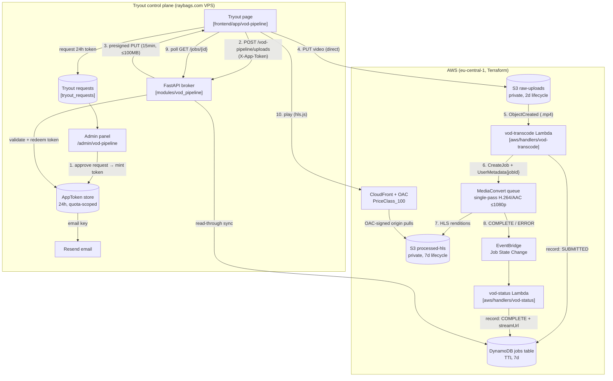

# VOD & HLS Packaging Pipeline — Architecture

Serverless video-on-demand pipeline. A visitor uploads a short clip from
`raybags.com/vod-pipeline`; the browser PUTs it straight into a private S3
bucket through a bounded presigned URL; AWS MediaConvert packages it into
multi-rendition HLS; the result streams back through CloudFront (OAC).

Every run costs real money (MediaConvert minutes), so usage is **token-only**:
the admin approves a tryout request, the platform emails a 24-hour,
quota-limited key, and only that key can presign uploads.

[Open the interactive diagram on GitDiagram](https://gitdiagram.com/raybags-dev/portfolio-base)

## Cost guardrails

- **Token-only uploads** — no anonymous runs; every transcode is tied to an
  admin-issued key (`max_uses` quota, 24h TTL, single-IP redemption).
- **Single-pass, ≤1080p** enforced in both the Lambda builder
  (`renditionsFor` throws above 1080p) and the Terraform variable validation.
- **Bounded uploads** — presign is scoped to `tryout/<jobId>/…` keys, 100 MB
  max, 15-minute expiry.
- **Auto-expiry** — raw uploads die after 2 days, HLS outputs after 7,
  DynamoDB records via TTL.
- **Budget alarm** — account-wide $10/month budget emails at 80% actual /
  100% forecasted; SNS DLQ alarm armed.
- **Teardown** — `make down` destroys everything; `scripts/aws-leftovers.sh`
  finds orphans by the `Project` tag.

## Key paths

| Piece | Location |
|---|---|
| Terraform module | `modules/vod-pipeline/` |
| Transcode handler | `aws/handlers/vod-transcode/` |
| Status handler | `aws/handlers/vod-status/` |
| Platform broker | `backend/app/modules/vod_pipeline/` |
| Tryout page | `frontend/app/vod-pipeline/` |
| Admin controls | `frontend/app/admin/vod-pipeline/` |
